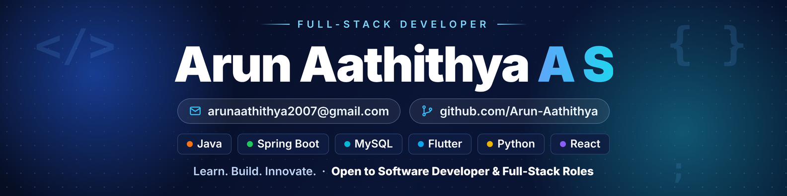

 

**Full-Stack Developer from Chennai, India**
Java / Spring Boot backends · React and Flutter frontends · IoT systems

---

## About me

I'm a third-year Computer Science Engineering student at **Dhaanish Ahmed College of Engineering** who likes taking a product from idea to a working system: database, API, user interface and, when needed, the hardware. I prefer clean, explainable solutions over buzzwords, and I ship projects end to end.

- Building full-stack systems with **Spring Boot, MySQL and React**
- Building **IoT + AI** projects that connect real sensors to live dashboards
- Competed in **Hack-AI-Thon 2.0** and built the prototype for our entry
- Looking for **internship and Software Developer / Full-Stack** opportunities in Chennai (on-site, hybrid or remote)

## Tech stack

  

| Area | Tools |
|---|---|
| Backend | Java, Spring Boot, Spring Data JPA, REST APIs, Node.js, Python, FastAPI |
| Frontend | JavaScript, React, HTML, CSS, Chart.js |
| Mobile | Flutter, Dart |
| Data | MySQL, SQL, JDBC |
| IoT and messaging | ESP32, MQTT, WebSockets |
| Tools | Git, GitHub, Maven, npm |

## Featured projects

| Project | What it is | Stack |
|---|---|---|
| [**Inventory Management POS**](https://github.com/Arun-Aathithya/Inventory_POS) | Full-stack POS and inventory platform: transactional billing, PDF invoices, low-stock and expiry alerts, analytics dashboard, reorder and pricing suggestions, fraud detection | `Java` `Spring Boot` `MySQL` `JavaScript` |
| [**TrustGuard AI**](https://github.com/Arun-Aathithya/TrustGuard) | Predictive-maintenance system that scores how much to trust each sensor and prediction. ESP32 sensor node streaming over MQTT to a FastAPI backend and React dashboard | `ESP32` `MQTT` `FastAPI` `React` `Python` |
| [**Traitor in the Room**](https://github.com/Arun-Aathithya/Traitor-in-the-room) | Real-time multiplayer social-deduction game for phone and PC players together, with rooms, accounts, a credits shop and a creator dashboard (in development) | `Node.js` `WebSockets` `PWA` |
| [**ScoreBoard Arena**](https://github.com/Arun-Aathithya/ScoreBoard_Arena) | Sports tournament dashboard for teams, players, live match scoring, standings and statistics | `Next.js` `TypeScript` `Tailwind` `Supabase` |
| **Digital Monastery** | Hack-AI-Thon 2.0 competition entry (Team Future Crafters): digitizing monastery heritage with offline capture kits, AI-assisted script reading and blockchain-backed authenticity. I built the prototype | `Prototyping` `AI/ML` `Blockchain` |

## Currently

- Polishing my projects with documentation, screenshots and tests
- Strengthening data structures, algorithms and problem solving ([LeetCode practice](https://github.com/Arun-Aathithya/Leet-Code))

## Connect

- LinkedIn: [arun-aathithya-676297329](https://www.linkedin.com/in/arun-aathithya-676297329)
- Email: [arunaathithya2007@gmail.com](mailto:arunaathithya2007@gmail.com)

*Learn. Build. Innovate.*

